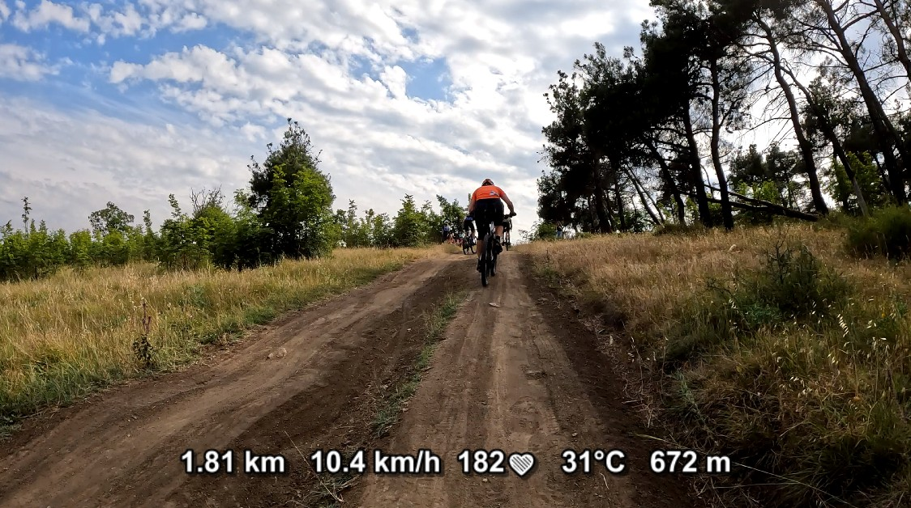

# FIT Telemetry Converter – Add Live Ride Data to Your Videos (No Re-Encoding Required)

**FIT Telemetry Converter** is a simple yet powerful tool that turns your **.FIT activity files** (from Garmin, Wahoo, Bryton, Suunto, or any FIT-compatible device) into **subtitles** that overlay your speed, heart rate, cadence, power, and elevation directly on your ride or run videos — *without* re-encoding the video.

That means you can record your action camera footage and your cycling computer or smartwatch activity separately, then easily synchronize them later for YouTube or local playback — all without touching the video quality.


Don’t want to deal with command-line tools? Try the web version - it even supports YouTube sync! Click here for the web-based app - [telemetry-subtitles](https://crea7or.link/telemetry-subtitles/).

---

## What It Does

This tool reads data from your recorded **.FIT** file (fitness telemetry) and exports:
- **.VTT** subtitles – directly usable by YouTube or media players (VLC, MPC-HC, etc.)
- **.JSON** files – for web previews, advanced integration, or custom overlays

You can then:
- Upload the `.vtt` file to **YouTube** as captions (see [YouTube captions upload guide](https://support.google.com/youtube/answer/2734796))
- Or place the `.vtt` file next to your video locally for any modern player to show real-time telemetry while watching

No conversion or editing of the video file itself — subtitles simply "float" over playback.

---

## Why It's Useful

Whether you're a cyclist, runner, or triathlete, you often record two things:
1. A video of your ride or run
2. A `.fit` activity file with telemetry (speed, power, heart rate, etc.)

**FIT Telemetry Converter** combines those worlds by letting you overlay your performance data directly on your video timeline — perfect for:
- **YouTube uploads** of races or rides with live metrics
- **Training analysis** videos
- **Action camera footage** synced with fitness sensors

All with zero video re-encoding, so your footage stays 100% original quality.

---

## Usage

```
usage: fitconvert -i input_file -o output_file -t output_type -m offset -s N -v units -d data_types -f format
```

### Parameters
| Flag | Description |
|------|--------------|
| `-i` | Path to `.fit` file (input data), or `stdin` |
| `-o` | Path to output file (`.vtt` or `.json`), or `stdout` |
| `-t` | Output type (`vtt` or `json`) – default is `vtt` |
| `-m` | Offset in milliseconds (optional, syncs telemetry start with video start) |
| `-s` | Smoothness value (optional, 0–5) – controls interpolation between data points for smoother graphs or frequent updates |
| `-v` | Values format: metric or imperial (optional, default metric) |
| `-d` | Data to process, comma delimited (optional, default all): `speed,distance,heartrate,power,cadence,temperature,gradient,altitude,latitude,longitude` |
| `-f` | Custom VTT format (optional): fields delimited by `;`, each field is `label{name:spec}suffix` using [fmt](https://fmt.dev/latest/syntax/) format specs, e.g. `{speed:5.1f} km/h;HR {heartrate:3}` |

#### Example of offset
- **Positive offset:** your video started *after* the activity → move telemetry earlier
- **Negative offset:** you started recording the video *before* the FIT recording → delay telemetry to match

---

## Example Workflow

1. Record a ride with your Garmin (or similar) and your action camera.
2. Export the `.fit` file from your device.
3. Run:
   ```bash
   fitconvert -i ride.fit -o ride.vtt -m 3000 -s 3
   ```
   *(This applies a 3-second sync offset and smooths telemetry)*
4. Put `ride.vtt` next to your video file with the same name as video but with .vtt extension and play it — or upload it to YouTube as subtitles.

---

## Optional: Embed Subtitles into a Video

You can also "bake" subtitles into your MP4 file without re-encoding:

```bash
ffmpeg -i video.mp4 -i ride.vtt -c copy -c:s mov_text output.mp4
```

This process is instant and keeps the original quality.

---

## Example Results

**Local playback (Media Player Classic):**


**YouTube upload:**
[Watch on YouTube](https://www.youtube.com/watch?v=fV2acJ4XffM)


---

## Building from Source

Works on Windows and Linux.
Tested with:
- Visual Studio 2019/2022 (Open as Folder)
- GCC on Ubuntu
- Uses **Conan** for dependencies and **CMake** as the build system

Example setup for Visual Studio 2022:
```bash
 conan install . -s build_type=Release --build=missing
 conan install . -s build_type=Debug --build=missing
 cmake -B build -S . -G "Visual Studio 17 2022" -DCMAKE_TOOLCHAIN_FILE=build/generators/conan_toolchain.cmake
 # Open build\fit2srt.sln
```

### Tests

Tests use GoogleTest and need no data files: `fit_writer.h` builds synthetic `.fit` files in memory.

```bash
cmake --build build --config Release --target fitconvert-tests
build/Release/fitconvert-tests
```

Coverage (clang or clang-cl, source based coverage; gcc uses gcov):

```bash
cmake -B build-cov -S . -G Ninja -DCMAKE_CXX_COMPILER=clang-cl -DCMAKE_C_COMPILER=clang-cl -DFITCONVERT_COVERAGE=ON ...
cmake --build build-cov --target fitconvert-tests
LLVM_PROFILE_FILE=tests.profraw build-cov/fitconvert-tests
llvm-profdata merge -sparse tests.profraw -o tests.profdata
llvm-cov report build-cov/fitconvert-tests -instr-profile=tests.profdata parser.cpp datasource.cpp
```

Note: rapidjson 1.1.0 does not compile with clang 19+ out of the box, add `-fdelayed-template-parsing` to `CMAKE_CXX_FLAGS`.

### Benchmarks

Benchmarks use Google Benchmark on synthetic 1 hour and 10 hour rides plus micro benchmarks of the per record code.
A real activity is benchmarked too when given with `--fit_file=path` (or `FITCONVERT_BENCH_FILE`, or `./300.fit` if it exists):

```bash
build/Release/fitconvert-bench --fit_file=ride.fit
build/Release/fitconvert-bench --benchmark_filter=BM_ConvertVtt --benchmark_repetitions=5
```

---

## License

MIT License Copyright © 2025**pavel.sokolov@gmail.com** / **CEZEO Software Ltd.**

Part of this repository includes Garmin's [FIT SDK](https://developer.garmin.com/fit/download/) (in the `fitsdk/` folder), distributed under its respective license.

---

## About This Project

FIT Telemetry Converter is part of the **CEZEO Software** ecosystem — focused on creating efficient, portable, and open tools.

```
      .:+oooooooooooooooooooooooooooooooooooooo: `/ooooooooooo/` :ooooo+/-`
   `+dCEZEOCEZEOCEZEOCEZEOCEZEOCEZEOCEZEOCEZEOEZshCEZEOCEZEOEZ#doCEZEOEZEZNs.
  :CEZEON#ddddddddddddddddddddddddddddddNCEZEO#h.:hdddddddddddh/.yddddCEZEO#N+
 :CEZEO+.        .-----------.`       `+CEZEOd/   .-----------.        `:CEZEO/
 CEZEO/         :CEZEOCEZEOEZNd.    `/dCEZEO+`   sNCEZEOCEZEO#Ny         -CEZEO
 CEZEO/         :#NCEZEOCEZEONd.   :hCEZEOo`     oNCEZEOCEZEO#Ny         -CEZEO
 :CEZEOo.`       `-----------.`  -yNEZ#Ns.       `.-----------.`       `/CEZEO/
  :CEZEONCEZEOd/.ydCEZEOCEZEOdo.sNCEZEOCEZEOCEZEOCEZEOCEZEOCEZEOCEZEOEZNEZEZN+
   `+dCEZEOEZEZdoCEZEOCEZEOEZ#N+CEZEOCEZEOCEZEOCEZEOCEZEOCEZEOCEZEOCEZEOEZ#s.
      .:+ooooo/` :+oooooooooo+. .+ooooooooooooooooooooooooooooooooooooo+/.
 C E Z E O  S O F T W A R E (c) 2025   FIT telemetry to subtitles converter
```

